# Experimental CMS (ExpCMS)

> **Version:** 3.11.0 &nbsp;|&nbsp; **Package:** PKG33 &nbsp;|&nbsp; **Database Engine:** MFDB (BEJSON 104a) &nbsp;|&nbsp; **Runtime:** Python 3.10+  
> **Author:** Elton Boehnen &nbsp;|&nbsp; [boehnenelton2024.pages.dev](https://boehnenelton2024.pages.dev) &nbsp;|&nbsp; [GitHub](https://github.com/boehnenelton) &nbsp;|&nbsp; `boehnenelton2024@gmail.com`

---

## Table of Contents

- [1. Overview & Architectural Vision](#1-overview--architectural-vision)
- [2. Comprehensive Feature Matrix](#2-comprehensive-feature-matrix)
  - [2.1 Content Management & Editorial Suite](#21-content-management--editorial-suite)
  - [2.2 Embeddable Widget Framework](#22-embeddable-widget-framework)
  - [2.3 Intelligent Document & HTML Ingestion](#23-intelligent-document--html-ingestion)
  - [2.4 Dynamic Category Feeds & Layouts](#24-dynamic-category-feeds--layouts)
  - [2.5 Standalone Web Application Hosting](#25-standalone-web-application-hosting)
  - [2.6 Media Library & YouTube Asset Pipeline](#26-media-library--youtube-asset-pipeline)
  - [2.7 Static Site Generator (SSG)](#27-static-site-generator-ssg)
  - [2.8 System Administration, Backup & Repack Engine](#28-system-administration-backup--repack-engine)
- [3. Architecture & Data Flow](#3-architecture--data-flow)
- [4. Schema Registry & Owning Writers](#4-schema-registry--owning-writers)
- [5. Directory & Subfolder Architecture](#5-directory--subfolder-architecture)
- [6. Installation & Prerequisites](#6-installation--prerequisites)
- [7. Quick Start & Execution](#7-quick-start--execution)
  - [7.1 Running the Admin Dashboard](#71-running-the-admin-dashboard)
  - [7.2 Direct Static Site Generation](#72-direct-static-site-generation)
  - [7.3 Integrated Preview Server](#73-integrated-preview-server)
- [8. Configuration & Environment Variables](#8-configuration--environment-variables)
- [9. Security Hardening & Integrity Guarantees](#9-security-hardening--integrity-guarantees)
- [10. Testing & Verification](#10-testing--verification)
- [11. Documentation Hierarchy](#11-documentation-hierarchy)
- [12. Author, Credits & License](#12-author-credits--license)

---

## 1. Overview & Architectural Vision

**Experimental CMS (ExpCMS)** is a hybrid content management ecosystem and static site compilation engine engineered around the **BEJSON 104a Multi-File Database (MFDB)** specification. It delivers the authoring convenience, relational asset management, and interactive control of a dynamic administrative dashboard alongside the speed, security, and portability of an uncompromised, zero-dependency static HTML website.

Unlike traditional CMS platforms bound to external relational database servers (MySQL, PostgreSQL) or opaque binary engines (SQLite), ExpCMS persists all structured data—pages, categories, media metadata, navigation hierarchies, and site configuration—directly into clean, auditable, schema-enforced BEJSON manifests and entity records.

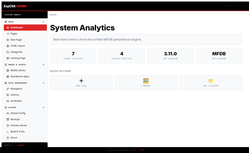
*_Figure 1: Unified Admin Analytics & Dashboard_*

### Core Pillars
- **Zero-CDN Portability:** Every compiled static page and embeddable widget operates strictly self-contained, requiring zero external runtime stylesheets, script libraries, or CDN assets.
- **Pure MFDB Persistence:** Relational entity storage leveraging atomic JSON writes with zero database server overhead, instant portability, and automated zip-based archival.
- **Dual-Mode Operation:** Full-featured local administrative console (`EXPCMS.py`) backed by a deterministic, batch static site builder (`EXPCMS_Builder.py`) targeting `Processing/www/`.
- **Hardened Security Baseline:** Comprehensive defense against Cross-Site Scripting (XSS), Zip-Slip archive path traversals, unsafe file ingestion, and CSRF mutations on destructive operations.

---

## 2. Comprehensive Feature Matrix

### 2.1 Content Management & Editorial Suite
- **Rich Page Lifecycle:** Complete CRUD management for articles, landing pages, and documentation articles with custom titles, URL slugs, author associations, and featured imagery.
- **Slug Collision Resolution:** Automatic uniqueness verification with numeric suffix resolution (e.g., `slug`, `slug-2`) ensuring consistent routing without silent content overwrites.
- **Specialized Content Page Types:** Tailored editor modes and rendering pipelines for:
  - *Standard Articles / Blog Posts*
  - *Video Players* (Native HTML5 video and responsive YouTube streaming)
  - *PDF Document Viewers*
  - *Source Code & Snippet Showcases*
  - *Embedded Standalone Application Wrappers*
- **Sibling Content Discovery:** Automatic calculation and rendering of related articles (up to 3 sibling entries sharing the same category) under a dedicated "More from `<category>`" section.
- **Integrated Author Profiles:** Explicit entity resolution linking author UUIDs to rich bio blocks, avatars, and social links rendered within article footers.
- **Orphan Prevention:** Defensive fallback automatically routing pages with empty category inputs to `'uncategorized'`, eliminating invisible or unreachable entity states.

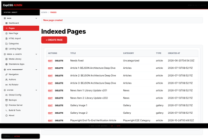
*_Figure 2: Content Architect & Atomic Page Editor_*

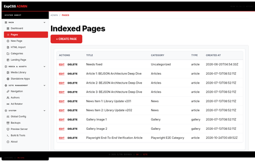
*_Figure 3: Indexed Pages Table & Lifecycle Actions_*

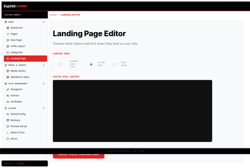
*_Figure 4: Landing Page Configuration & Visual Mode_*

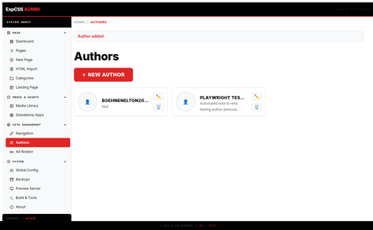
*_Figure 5: Author Management & Avatar Asset Resolution_*

### 2.2 Embeddable Widget Framework
ExpCMS features an isolated widget registry (`lib_bejson_ExpCMS_widgets.py`) adhering to a strict portability contract:
- **Instance Scoping:** Every widget invocation receives an 8-character cryptographic instance ID (`widget-<name>-<id>`) namespacing all CSS selectors and JS execution scopes.
- **Zero Style Bleed:** Prevents styling collision between parent site templates and embedded elements.
- **Available Widget Catalog:**
  - **Social Links Bar:** Responsive wrap layout featuring SVG/glyph platform badges for GitHub, X/Twitter, LinkedIn, YouTube, Instagram, Discord, Email, and generic web links.
  - **Call-to-Action (CTA) Box:** High-conversion content card featuring title, descriptive body copy, and customizable action button with accent color highlights.
  - **YouTube Video Embed:** Clean 16:9 aspect-ratio responsive frame utilizing intrinsic padding scaling without external JavaScript dependencies.
- **Modal Widget Picker:** Integrated directly into the page editor textarea (`/widgets/picker`), allowing point-and-click widget generation and instant HTML insertion.

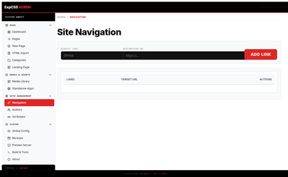
*_Figure 6: Global Navigation Links & Hierarchy Manager_*

### 2.3 Intelligent Document & HTML Ingestion
- **Automated Document Cleaning:** Ingests legacy HTML files and Microsoft Word exports directly into native ExpCMS pages via BeautifulSoup.
- **Cruft & Tracker Stripping:** Automatically purges inline `<script>` tags, `<style>` definitions, Microsoft Office formatting artifacts (`mso-*`), tracking attributes, and AI-generator watermark footers.
- **Resilient Fallback:** Implements high-throughput regex extraction when BeautifulSoup is unavailable in constrained runtime environments.

### 2.4 Dynamic Category Feeds & Layouts
ExpCMS provides six distinct visual category layouts defined in `HTML_Skeletons/Category_Feed_Skeleton.html` and `Components/body/`:
1. **Blog (`blog`):** Classic chronological feed featuring featured imagery, publication timestamps, and editorial excerpts.
2. **News (`news`):** Compact, high-density editorial listing optimized for quick scanning and frequent updates.
3. **Products (`products`):** Showcase card layout with prominent product imagery, structured specs, and conversion links.
4. **Masonry (`masonry`):** Dynamic Pinterest-style staggered card grid balancing varied image aspect ratios.
5. **Gallery (`gallery`):** Media-centric visual portfolio routed through optimized masonry cards.
6. **App Hub (`app`):** Application launch directory presenting interactive tools and standalone software packages.

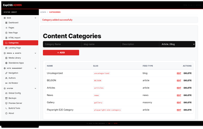
*_Figure 7: Dynamic Category Management & Feed Types_*

### 2.5 Standalone Web Application Hosting
- **Arbitrary Web App Hosting:** Upload, unpack, and host standalone single-page applications (SPAs), browser utilities, HTML5 games, and interactive models under `/apps/<uuid>/`.
- **Zip-Slip Hardening:** All uploaded ZIP packages pass through `safe_extract_zip()` with strict boundary validation, preventing path traversal attacks.
- **Sandboxed Iframe Integration:** Public built site wraps hosted applications in sandboxed iframes (`sandbox="allow-scripts allow-same-origin"`) with explicit 80vh responsive height bounds.
- **Entry File Verification:** Validates designated entry points against actual archive contents before committing records to the database.

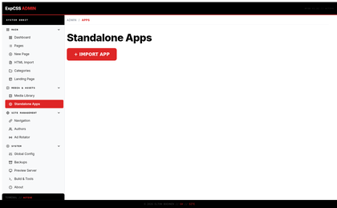
*_Figure 8: App Hub & Standalone Web App Manager_*

### 2.6 Media Library & YouTube Asset Pipeline
- **Multi-File & Directory Uploads:** Supports drag-and-drop batch ingestion and recursive directory uploads (`webkitdirectory`).
- **MIME Sniffing & Sanitization:** Automatically resolves missing browser Content-Types via `mimetypes.guess_type` and sanitizes non-ASCII filenames using cryptographic hash prefixes (`asset_{hash8}{ext}`).
- **Keyless YouTube Ingestion:** Ingests YouTube media by URL, supporting standard (`watch?v=`), shortened (`youtu.be/`), embedded (`/embed/`), and short-form (`/shorts/`) syntax.
- **Automated Thumbnail Derivation:** Extracts the 11-character video ID and pulls high-resolution poster thumbnails directly from Google video edge caches without requiring YouTube Data API keys.

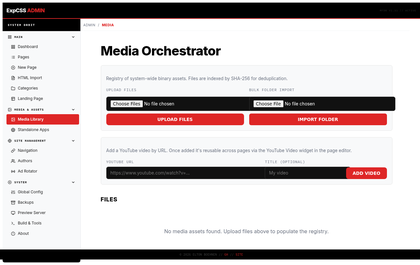
*_Figure 9: Central Media Asset Library & Folder Browser_*

### 2.7 Static Site Generator (SSG)
- **High-Performance Compilation:** `EXPCMS_Builder.py` reads directly from the live MFDB content repository and compiles a complete, self-contained static site into `Processing/www/`.
- **Autoescape Security:** Implements an autoescape-enforced Jinja2 compilation environment, eliminating XSS vectors across category titles, metadata, and sidebar links.
- **Full Asset Mirroring:** Automatically deploys uploaded media assets, active hosted web apps, and shared component stylesheets directly into the build output.
- **Automated Sitemap Generation:** Compiles a production-ready `sitemap.xml` mapping the homepage, category feeds, individual articles, and hosted app wrappers.

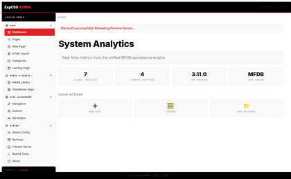
*_Figure 10: Static Site Generator Build Output_*

### 2.8 System Administration, Backup & Repack Engine
- **Workspace Repack:** Synchronizes and compacts live runtime workspaces (`Data/workspace/db_global/`, `Data/workspace/db_content/`) into compressed master archives (`Data/global_master.mfdb.zip`, `Data/content_master.mfdb.zip`).
- **Portable Chunking Backups:** Leverages `CMS_Chunker_Wrapper` and `lib_bejson_ExpCMS_mfdb_chunker_v6.py` to produce portable single-file database backups with safe path traversal guards (`bejson_safe_join`).
- **Deterministic Factory Reset:** Restores the entire system to a known canonical baseline using isolated write routines.
- **CSRF-Protected Actions:** Destructive operations (database resets, repacks, entity deletions) are enforced as POST-only endpoints.

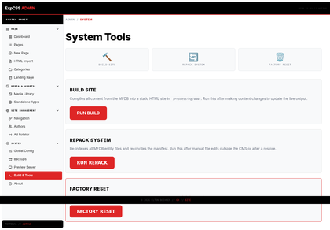
*_Figure 11: System Diagnostics & Live MFDB Telemetry_*

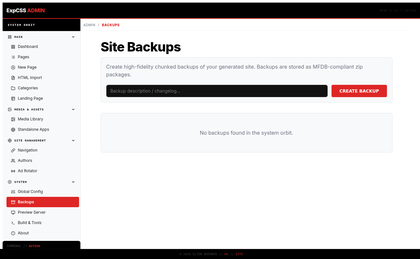
*_Figure 12: Database Repack, Snapshots & Backups Engine_*

---

## 3. Architecture & Data Flow

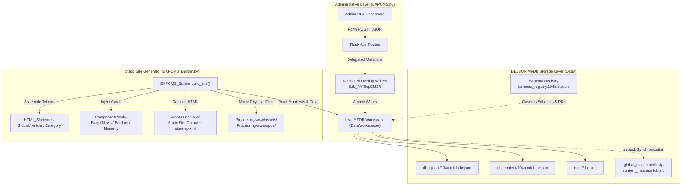

---

## 4. Schema Registry & Owning Writers

Starting in PKG33, ExpCMS operates under a formalized **Schema Registry & Owning Writer Architecture** ensuring strict relational integrity, field map caching, and zero positional array indexing across all operations:

### 4.1 Schema Registry (`Data/schema_registry.104a.bejson`)
The canonical registry formalizes all 9 entities, their immutable UUIDv4 primary keys, relational foreign keys, deletion cascade policies, and designated single write-owner modules:

| Entity Name | Primary Key | Parent Manifest | Designated Owning Writer | Cascade Rules |
|---|---|---|---|---|
| **Category** | `category_uuid` | `db_content` | `CategoryOwningWriter` | Orphaned pages reassign to default `uncategorized` |
| **Page** | `page_uuid` | `db_content` | `PageOwningWriter` | Cascade delete on child `PageContent` records |
| **PageContent** | `content_uuid` | `db_content` | `PageOwningWriter` | Dependent 1:1 entity owned by Page writer |
| **StandaloneApp** | `app_uuid` | `db_content` | `StandaloneAppOwningWriter` | Standalone app assets bound to application UUID |
| **AuthorProfile** | `author_uuid` | `db_global` | `AuthorOwningWriter` | Restrict deletion if active pages reference author |
| **MediaAsset** | `asset_uuid` | `db_global` | `MediaOwningWriter` | Physical file unlinked upon database deletion |
| **SiteConfig** | `config_uuid` | `db_global` | `SiteConfigOwningWriter` | Single-row system configuration key-values |
| **NavLink** | `nav_uuid` | `db_global` | `NavLinkOwningWriter` | Header and sidebar navigation order indices |
| **SocialLink** | `social_uuid` | `db_global` | `SocialLinkOwningWriter` | Footer and author social channel badges |

### 4.2 Single-Responsibility Owning Writers (`Lib_PY/ExpCMS/`)
- [`CategoryOwningWriter`](Lib_PY/ExpCMS/lib_bejson_ExpCMS_category_writer.py): Manages category creation, slug uniqueness, and safe cascade reassignments.
- [`PageOwningWriter`](Lib_PY/ExpCMS/lib_bejson_ExpCMS_page_writer.py): Handles atomic 1:1 writes across `Page` and `PageContent` with automated child cascade deletion.
- [`AuthorOwningWriter`](Lib_PY/ExpCMS/lib_bejson_ExpCMS_author_writer.py): Governs author profile lifecycles, avatars, and bios.
- [`MediaOwningWriter`](Lib_PY/ExpCMS/lib_bejson_ExpCMS_media_writer.py): Governs media asset registration, mime-type classification, and disk unlinking.

---

## 5. Directory & Subfolder Architecture

```
Experimental_CMS/
├── EXPCMS.py                         # Admin Flask application & routing controller
├── EXPCMS_Builder.py                 # Static site generator engine
├── requirements.txt                  # Python runtime package dependencies
├── LICENSE                           # PolyForm Noncommercial 1.0.0 license terms
├── README.md                         # Authoritative project overview & manual
├── .bejson_project.json              # Canonical BEJSON project identity & changelog
│
├── Components/                       # Static site component fragments
│   └── body/                         # Feed card templates (Blog, News, Product, Masonry)
├── HTML_Skeletons/                   # Core page shells (Global, Article, Category_Feed)
│
├── Data/                             # Permanent MFDB database storage
│   ├── schema_registry.104a.bejson   # Canonical entity schema & relational registry
│   ├── content_master.mfdb.zip       # Seed master archive for content database
│   ├── global_master.mfdb.zip        # Seed master archive for global system database
│   └── workspace/                    # Active live MFDB runtime workspace
│       ├── db_content/               # Categories, pages, page content, standalone apps
│       └── db_global/                # Ads, authors, media assets, nav links, site config
│
├── Lib_PY/                           # Canonical library families (sys.path loaded)
│   ├── Core/                         # Low-level BEJSON/MFDB core engine
│   ├── HTML/                         # Shared CSS tokens, Brutal tables, HTML3 renderers
│   └── ExpCMS/                       # Owning writers, widget registry, chunker wrappers
│       ├── lib_bejson_ExpCMS_category_writer.py
│       ├── lib_bejson_ExpCMS_page_writer.py
│       ├── lib_bejson_ExpCMS_author_writer.py
│       └── lib_bejson_ExpCMS_media_writer.py
│
├── images/                           # 420p aspect-scaled visual UI documentation tours
├── templates/                        # Admin console Jinja2 templates (admin_base.html)
│   └── components/backend/           # Reusable admin UI widgets (Data-Table, Form-Row)
├── static/                           # Dedicated static folder for admin assets
│
├── docs/                             # Technical guides, architecture & policies
│   ├── architecture.md               # Deep-dive architectural component breakdown
│   ├── usage-guide.md                # Complete administrative route reference
│   ├── CHANGELOG.md                  # Comprehensive version release log
│   ├── CONTRIBUTING.md               # Guidelines for contributions
│   └── SECURITY.md                   # Vulnerability disclosure policy
│
└── dev/                              # Internal developer notes & audit registries
    ├── AGENTS.md                     # Agent coding guidelines & library contracts
    ├── audit.md                      # Audit remediation tracking
    ├── audit-2026-08-11.md           # Full security audit report
    ├── cleanup-log.md                # Dead-code removal & refactoring history
    ├── security-notes.md             # Detailed vulnerability patch records
    ├── migrate_taxonomy_v2.py        # Database migration script for Taxonomy v2.0
    └── run_e2e_playwright_test.py    # Automated Playwright E2E verification test suite
```

---

## 6. Installation & Prerequisites

ExpCMS requires **Python 3.10** or newer.

```bash
# Clone or navigate to the project directory
git clone https://github.com/boehnenelton/Experimental_CMS.git
cd Experimental_CMS

# Install core runtime dependencies
pip install -r requirements.txt
```

### Dependency Roster
- `Flask>=3.0` — Administrative web server and routing framework.
- `Jinja2>=3.1` — Fast, hardened template engine with autoescaping.
- `Werkzeug>=3.0` — WSGI utility library and path security primitives.
- `beautifulsoup4>=4.12` — Document sanitization and HTML cruft stripping.
- `Pillow>=10.0` — Image processing and 420p aspect-ratio scaling.

---

## 7. Quick Start & Execution

### 7.1 Running the Admin Dashboard
Launch the unified administrative dashboard on port `5005`:

```bash
python3 EXPCMS.py
```

Open your browser to:
```
http://127.0.0.1:5005/
```

From the dashboard, you can author pages, upload media, configure navigation, manage categories, and launch builds.

### 7.2 Direct Static Site Generation
You can execute static compilation directly from the command line without launching the web server:

```bash
python3 EXPCMS_Builder.py
```

Compilation builds directly to `Processing/www/`, outputting:
- `Processing/www/index.html` (Landing page)
- `Processing/www/<category_slug>/index.html` (Category feeds)
- `Processing/www/<category_slug>/<page_slug>/index.html` (Individual pages)
- `Processing/www/apps/<app_uuid>/...` (Unpacked standalone applications)
- `Processing/www/assets/...` (Media library files)
- `Processing/www/sitemap.xml` (Full XML sitemap)

### 7.3 Integrated Preview Server
The admin panel includes an integrated background HTTP daemon to inspect generated sites before deployment.
- **Start Preview Daemon:** Navigate to `/srv/start` or access the **Build & Tools** section.
- **Stop Preview Daemon:** Navigate to `/srv/stop`.
- Default preview endpoint binds to `http://127.0.0.1:8000/`.

---

## 8. Configuration & Environment Variables

ExpCMS is designed to operate out-of-the-box with secure defaults, but supports runtime tuning via environment variables:

| Variable | Default | Purpose |
|---|---|---|
| `EXPCMS_SECRET_KEY` | *(Random UUID4)* | Flask session signing key. **Must be defined in production** to preserve user login sessions across process restarts. |
| `EXPCMS_HOST` | `127.0.0.1` | Network interface binding for the administrative Flask dashboard. |
| `EXPCMS_PORT` | `5005` | TCP listening port for the administrative Flask dashboard. |
| `EXPCMS_PREVIEW_HOST` | `127.0.0.1` | Network interface binding for the built static site preview server. |
| `EXPCMS_PREVIEW_PORT` | `8000` | TCP listening port for the built static site preview server. |

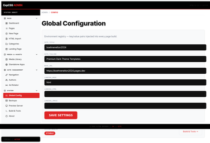
*_Figure 13: System Configuration & Environment Variables_*

---

## 9. Security Hardening & Integrity Guarantees

ExpCMS has undergone rigorous security auditing to establish an enterprise-grade defensive posture:

- **Loopback Enforcement:** Both the admin application and preview daemons default strictly to `127.0.0.1`, preventing inadvertent exposure over public or local network interfaces.
- **Cross-Site Scripting (XSS) Prevention:**
  - All builder template executions enforce strict Jinja2 autoescaping.
  - Widget renderers explicitly sanitize dynamic parameters using `html.escape(..., quote=True)`.
  - Ingested HTML documents are sanitized with BeautifulSoup to eliminate embedded `<script>`, tracking tags, and malicious attributes.
- **Path Traversal & Zip-Slip Immunity:**
  - Standalone app ZIP uploads pass through `safe_extract_zip()` to ensure extracted files remain bounded to their destination directory.
  - Database unchunking routines leverage `bejson_safe_join()` to guard against malicious path injections in archive manifests.
- **CSRF Defense on State Mutations:**
  - Destructive administrative endpoints (`/factory_reset`, `/repack`, and all delete handlers) are restricted to `POST` methods, neutralizing image-tag and link-traversal CSRF vectors.
- **Client Application Sandboxing:**
  - Uploaded standalone apps are embedded with `sandbox="allow-scripts allow-same-origin"` on public built pages.

---

## 10. Testing & Verification

ExpCMS includes an automated end-to-end (E2E) Playwright verification test suite (`dev/run_e2e_playwright_test.py`) that tests the complete administrative lifecycle:

```bash
# Execute full E2E Playwright test suite
python3 dev/run_e2e_playwright_test.py
```

The test runner launches a background test server, executes 15 stage verification gates (dashboard, about, system, category creation, author creation, page authoring, pages index, admin tools, static site generation, and teardown cleanup), records high-resolution visual evidence, and generates a detailed audit report in `exports/reports/Experimental_CMS_E2E_Test_Report.md`.

---

## 11. Documentation Hierarchy

To maintain root directory hygiene, supplementary documentation is organized into dedicated subdirectories:

- **Public Reference & Architecture ([`docs/`](docs/)):**
  - [`docs/architecture.md`](docs/architecture.md) — Comprehensive technical architecture and module interactions.
  - [`docs/usage-guide.md`](docs/usage-guide.md) — Exhaustive routing, method signature, and API table.
  - [`docs/CHANGELOG.md`](docs/CHANGELOG.md) — Detailed historical release notes across all packages.
  - [`docs/CONTRIBUTING.md`](docs/CONTRIBUTING.md) — Contribution standards and submission guidelines.
  - [`docs/SECURITY.md`](docs/SECURITY.md) — Responsible disclosure protocol.
- **Internal Development & Tracking ([`dev/`](dev/)):**
  - [`dev/AGENTS.md`](dev/AGENTS.md) — Behavioral guidelines and coding contracts for collaborator agents.
  - [`dev/audit.md`](dev/audit.md) & [`dev/audit-2026-08-11.md`](dev/audit-2026-08-11.md) — Security and database audit records.
  - [`dev/security-notes.md`](dev/security-notes.md) — Technical vulnerability remediation tracking.
  - [`dev/cleanup-log.md`](dev/cleanup-log.md) — Historical dead code and module retirement logs.

---

## 12. Author, Credits & License

### Author & Engineering Credit
**Elton Boehnen**  
- **Email:** `boehnenelton2024@gmail.com`  
- **Portfolio:** [boehnenelton2024.pages.dev](https://boehnenelton2024.pages.dev)  
- **GitHub:** [github.com/boehnenelton](https://github.com/boehnenelton)

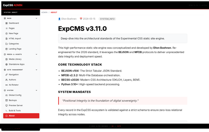
*_Figure 14: About ExpCMS & Architectural Attribution_*

### Licensing
This project is licensed under the **PolyForm Noncommercial License 1.0.0**.  
You are free to use, modify, and distribute this software for personal, educational, research, and non-commercial purposes. Any commercial deployment or utilization requires an explicit licensing agreement with the copyright holder. See [`LICENSE`](LICENSE) for complete terms.
