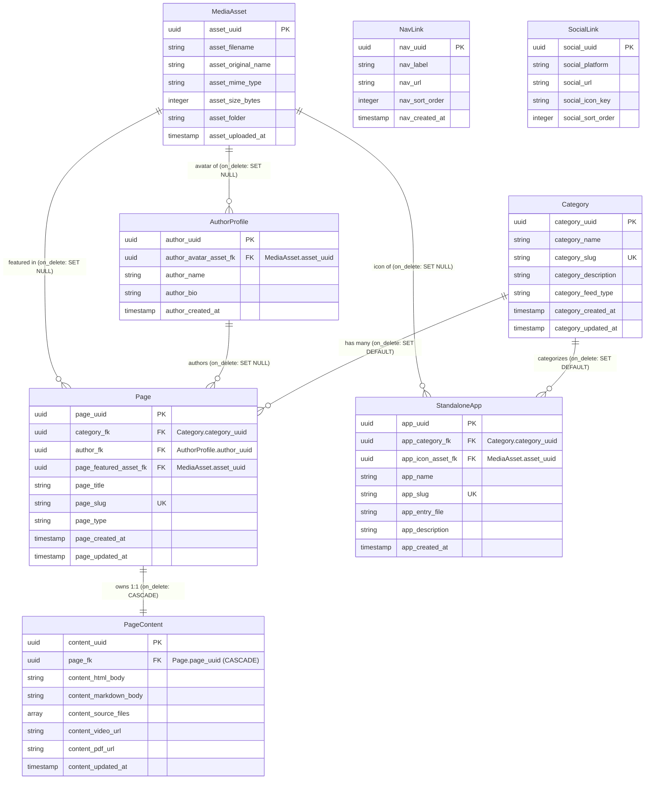

# Experimental CMS (EXPCMS) — Taxonomy Remapping Overhaul & Component Extraction Report

- **Author**: Elton Boehnen · boehnenelton2024@gmail.com · boehnenelton2024.pages.dev · github.com/boehnenelton
- **Target Repository**: `/storage/emulated/0/Admin/Dev/Repos/Experimental_CMS/`
- **Component Archive**: `/storage/emulated/0/Admin/Resources/Templates/Components/EXPCMS/`
- **Applicable Policies**: Policy §6.1, §6.2, §10.1, §10.2, §10.3, §10.4, §10.9
- **Governing Skills**: `component-taxonomy-architect` (Layer 5), `code-taxonomy-architect` (Layer 4), `web-ui-component-mapper`, `ui-navigation-decomposer`
- **Date**: 2026-10-24

---

## 1. Executive Summary

Following the synchronization and Playwright end-to-end audit of **Experimental CMS v3.11.0**, this architectural overhaul addresses foundational database limitations within the Multi-File Database (MFDB) storage layer. 

The current database architecture in `Data/workspace/db_global/` and `Data/workspace/db_content/` relies on mixed Foundational Era conventions with critical policy gaps (e.g., text-slug primary keys, `null` primary keys on relational entities, non-standard timestamp identifiers, and lack of formalized write ownership).

This specification establishes a **canonical, production-grade schema overhaul** that aligns Experimental CMS with Policy §10 Standards, providing seamless support for both **Foundational Era (`libraries_104`)** and **Integrity Era (`libraries_105`)** runtimes. Additionally, **22 modular UI and template components** have been extracted and cataloged into `/storage/emulated/0/Admin/Resources/Templates/Components/EXPCMS/` using Web UI decomposition.

---

## 2. Current State Audit & Policy Gap Analysis

An inspection of the active manifests (`Data/workspace/db_global/104a.mfdb.bejson` and `Data/workspace/db_content/104a.mfdb.bejson`) revealed the following structural deficiencies:

| Entity | Current Primary Key | Policy §10.3 Conformance | Gap Description |
|---|:---:|:---:|---|
| **`Category`** | `category_slug` | ❌ Non-Compliant | Uses a mutable human-entered text string as PK rather than an immutable UUIDv4. Slug edits break parent relationships. |
| **`Page`** | `page_uuid` | ⚠️ Partial | Valid UUIDv4 PK, but foreign keys reference mutable slug strings (`category_fk = "uncategorized"`) rather than category UUIDs. |
| **`PageContent`** | `null` | ❌ Non-Compliant | Lacks a primary key entirely. FK column is named `page_uuid_fk` (violates `_fk` suffix standard). |
| **`NavLink`** | `null` | ❌ Non-Compliant | Table has no PK. Records can only be updated via transient index offsets or text label match. |
| **`SocialLink`** | `null` | ❌ Non-Compliant | Table has no PK. Records can only be updated via platform label match. |
| **`SiteConfig`** | `config_key` | ⚠️ Permissible Exception | Natural key string `config_key`. Needs snake_case and `<entity>_created_at` timestamp alignment. |
| **`AuthorProfile`**| `author_uuid` | 🟢 Compliant | Proper UUIDv4 PK, but lacks `<entity>_created_at` timestamp. |
| **`MediaAsset`** | `asset_uuid` | 🟢 Compliant | Proper UUIDv4 PK, but column names lack entity prefix standardization. |
| **`StandaloneApp`**| `app_uuid` | 🟢 Compliant | Valid PK, but lacks foreign-key constraints to parent category. |

> [!WARNING]
> Under Policy §10.3 and §10.4, foreign keys must reference immutable parent UUID primary keys with explicit deletion rules (`cascade`, `null`, `default`, `restrict`), and every entity must have exactly **one designated Write-Owner module**. Direct ad-hoc mutations inside `EXPCMS.py` routes violate single write ownership.

---

## 3. Remapped Relational Architecture (ER Diagram)

The remapped taxonomy establishes immutable UUIDv4 primary keys across all relational entities, normalizes all foreign keys to point exclusively to parent UUIDs, and enforces cascading lifecycle behavior:



---

## 4. Canonical Schema Registry v2.0 (`schema_registry.104a.bejson`)

Per Policy §10.1, the master schema registry establishes strict typing, key invariants, deletion cascades, and Write-Owner modules:

```json
{
  "Format": "BEJSON",
  "Format_Version": "104a",
  "Format_Creator": "Elton Boehnen",
  "Schema_Version": "2.0.0",
  "Project_Name": "Experimental_CMS",
  "Description": "Canonical Schema Registry and Relational Taxonomy Specification",
  "Records_Type": ["SchemaDefinition"],
  "Fields": [
    {"name": "entity_name", "type": "string"},
    {"name": "database_scope", "type": "string"},
    {"name": "file_rel_path", "type": "string"},
    {"name": "primary_key", "type": "string"},
    {"name": "foreign_keys", "type": "array"},
    {"name": "owning_writer_module", "type": "string"},
    {"name": "field_count", "type": "integer"}
  ],
  "Values": [
    [
      "Category",
      "db_content",
      "data/category.bejson",
      "category_uuid",
      [],
      "lib_bejson_ExpCMS_category_writer",
      7
    ],
    [
      "Page",
      "db_content",
      "data/page.bejson",
      "page_uuid",
      [
        {"column": "category_fk", "references": "Category.category_uuid", "on_delete": "default", "default_val": "00000000-0000-0000-0000-000000000001"},
        {"column": "author_fk", "references": "AuthorProfile.author_uuid", "on_delete": "null"},
        {"column": "page_featured_asset_fk", "references": "MediaAsset.asset_uuid", "on_delete": "null"}
      ],
      "lib_bejson_ExpCMS_page_writer",
      9
    ],
    [
      "PageContent",
      "db_content",
      "data/pagecontent.bejson",
      "content_uuid",
      [
        {"column": "page_fk", "references": "Page.page_uuid", "on_delete": "cascade"}
      ],
      "lib_bejson_ExpCMS_page_writer",
      8
    ],
    [
      "StandaloneApp",
      "db_content",
      "data/standaloneapp.bejson",
      "app_uuid",
      [
        {"column": "app_category_fk", "references": "Category.category_uuid", "on_delete": "default", "default_val": "00000000-0000-0000-0000-000000000001"},
        {"column": "app_icon_asset_fk", "references": "MediaAsset.asset_uuid", "on_delete": "null"}
      ],
      "lib_bejson_ExpCMS_app_writer",
      8
    ],
    [
      "AuthorProfile",
      "db_global",
      "data/authorprofile.bejson",
      "author_uuid",
      [
        {"column": "author_avatar_asset_fk", "references": "MediaAsset.asset_uuid", "on_delete": "null"}
      ],
      "lib_bejson_ExpCMS_author_writer",
      5
    ],
    [
      "MediaAsset",
      "db_global",
      "data/mediaasset.bejson",
      "asset_uuid",
      [],
      "lib_bejson_ExpCMS_media_writer",
      7
    ],
    [
      "NavLink",
      "db_global",
      "data/navlink.bejson",
      "nav_uuid",
      [],
      "lib_bejson_ExpCMS_global_writer",
      5
    ],
    [
      "SocialLink",
      "db_global",
      "data/sociallink.bejson",
      "social_uuid",
      [],
      "lib_bejson_ExpCMS_global_writer",
      5
    ],
    [
      "SiteConfig",
      "db_global",
      "data/siteconfig.bejson",
      "config_key",
      [],
      "lib_bejson_ExpCMS_global_writer",
      4
    ]
  ]
}
```

---

## 5. Decomposed Component Library Extraction (Task 2)

All UI views, form modules, feed cards, interactive widgets, and layout skeletons have been decomposed and saved into:
`/storage/emulated/0/Admin/Resources/Templates/Components/EXPCMS/`

```text
/storage/emulated/0/Admin/Resources/Templates/Components/EXPCMS/
├── backend/
│   ├── Admin-Base-Layout.html       (Master shell: CSS tokens, header, drawer, toast alerts)
│   ├── Admin-Sidebar-Nav.html       (57-column collapsible accordion navigation component)
│   ├── Admin-Stats-Bar.html         (Telemetry KPI metrics tiles component)
│   ├── Data-Table.html              (Relational data table with sorting, search, action buttons)
│   └── Widget-Picker-Modal.html     (Modal dialog with parameter form for injecting widgets)
│
├── editor/
│   ├── Content-Architect-Form.html  (Main article/page editor form with 6 content archetype options)
│   ├── Category-Manager-Form.html   (Inline category creator and grid management form)
│   ├── Author-Profile-Modal.html    (Backdrop blur modal for author biographical management)
│   ├── Landing-Section-Editor.html  (Interactive landing page hero & section customizer)
│   ├── Site-Config-Form.html        (Global configuration key-value management form)
│   └── Media-Dropzone-Card.html     (Dropzone file uploader and media asset manager)
│
├── frontend_body/
│   ├── Template-Feed-Item-Blog.html    (Standard editorial card with thumbnail, author pill, date)
│   ├── Template-Feed-Item-News.html    (Compact news feed row with category badge)
│   ├── Template-Feed-Item-Masonry.html (Visual gallery cell with hover overlay metadata)
│   ├── Template-Feed-Item-Product.html (Commercial product showcase card with score pill)
│   └── Template-Standard-Hero-Section-body-component.html (Hero section with dual CTAs)
│
├── widgets/
│   ├── Widget-Social-Links.html     (Portable 40x40px social icon link bar with CSS variables)
│   ├── Widget-CTA-Box.html          (Brutal high-contrast call-to-action card with #DE2626 button)
│   └── Widget-YouTube-Embed.html    (16:9 responsive aspect-ratio YouTube player wrapper)
│
├── skeletons/
│   ├── Global_Skeleton.html         (Full-canvas master public site skeleton with mobile drawer)
│   ├── Article_Skeleton.html        (Single post / documentation reader layout)
│   └── Category_Feed_Skeleton.html  (Archive index layout with dynamic category filter chips)
│
└── maps/
    └── EXPCMS_UI_Component_Map.md   (Complete 5-tier ASCII Component Architecture Blueprint)
```

---

## 6. Migration & Implementation Strategy

To transition Experimental CMS from legacy v3.11.0 to Taxonomy v2.0 without data loss:

1. **Step 1: Data Migration Script (`migrate_taxonomy_v2.py`)**:
   - Assign static UUID `00000000-0000-0000-0000-000000000001` to `uncategorized`.
   - Generate UUIDv4 for each existing category, page content, nav link, and social link.
   - Update `page.bejson` rows: translate textual `category_fk` ("articles", "uncategorized") into corresponding `category_uuid`.
   - Update column names to follow the `<entity>_<purpose>` prefix standard.

2. **Step 2: Owning Writer Extraction**:
   - Refactor `MFDB_CMS_Manager` into dedicated single-responsibility write modules in `Lib_PY/ExpCMS/`:
     - `lib_bejson_ExpCMS_page_writer.py`
     - `lib_bejson_ExpCMS_category_writer.py`
     - `lib_bejson_ExpCMS_author_writer.py`
     - `lib_bejson_ExpCMS_media_writer.py`

3. **Step 3: Frontend & Static Site Engine Updates**:
   - Update `EXPCMS_Builder.py` to join `Page.category_fk` against `Category.category_uuid` while generating feed URLs via `Category.category_slug`.
   - Update `EXPCMS.py` routes to resolve UUID foreign keys.

4. **Step 4: Automated Stage-Gate Validation**:
   - Re-run the Playwright E2E test suite (`dev/run_e2e_playwright_test.py`) to confirm zero regressions across all 15 test stages.

---

*Report prepared autonomously by Antigravity CLI adhering to Elton Boehnen's BEJSON & BEHTML Architectural Standards.*
